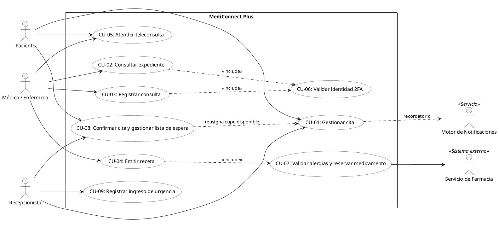
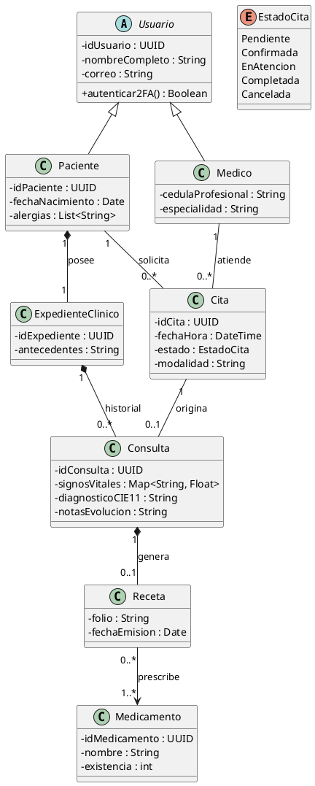
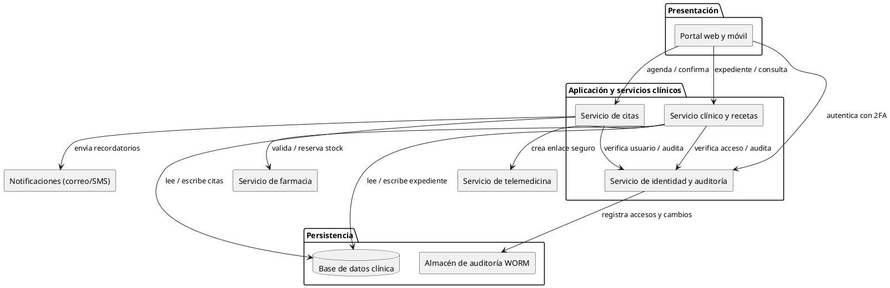

# Taller: Análisis de requisitos, del proyecto al modelo

**Materia:** Ingeniería de Requisitos
**Unidad II:** Elicitación y análisis de requisitos
**Duración:** 80 minutos
**Modalidad:** equipos de 3 o 4 estudiantes
**Entregable:** este mismo archivo `.md` completado (más su exportación a PDF)

---

## 0. Datos del equipo

| Campo | Respuesta |
|---|---|
| Nombre del proyecto | MediConnect Plus: Sistema Inteligente de Gestión Hospitalaria y Telemedicina |
| Integrantes | No especificados en las fuentes (por asignar) |
| Fecha | 21 de octubre de 2026 (fecha de elaboración) |

**Roles del equipo** (asignen uno por persona; en equipos de 3, una persona toma dos roles):

| Rol | Responsable | Función |
|---|---|---|
| Analista líder | Por asignar | Coordina el tiempo y revisa la coherencia del documento |
| Modelador | Por asignar | Escribe y renderiza los diagramas PlantUML |
| Arquitecto | Por asignar | Propone la arquitectura y la matriz de trazabilidad |
| Relator | Por asignar | Documenta la negociación y presenta la conclusión final |

---

## Objetivo

Producir un mini documento de análisis de requisitos de su proyecto real que cubra los cinco elementos de la unidad: **clasificación, modelamiento conceptual, diseño arquitectónico y asignación, negociación y análisis formal**.

## Distribución del tiempo

| Tiempo | Bloque | Producto |
|---|---|---|
| 0-10 min | Contexto | Problema, alcance e interesados |
| 10-25 min | 1. Clasificación | Tabla de 13 requisitos clasificados y priorizados |
| 25-40 min | 2. Modelamiento conceptual | Diagrama de casos de uso y diagrama de clases (PlantUML) |
| 40-50 min | 3. Arquitectura y asignación | Diagrama de componentes y matriz de trazabilidad |
| 50-62 min | 4. Negociación | 2 conflictos resueltos con formato WinWin |
| 62-75 min | 5. Análisis formal | 3 requisitos reescritos y verificados |
| 75-80 min | Cierre | Revisión, entrega y conclusión oral de 1 minuto |

> **Tip de tiempo:** el Modelador puede empezar los diagramas del bloque 2 mientras los demás terminan la clasificación. Si el tiempo no alcanza, reduzcan a 8 requisitos y hagan solo el diagrama de casos de uso.

---

## Bloque de contexto (0-10 min)

### Descripción del proyecto

Escriban en 3 líneas: el problema que resuelve el proyecto, su alcance (qué incluye y qué no) y a quién beneficia.

> MediConnect Plus reemplazará sistemas clínicos aislados y expedientes dispersos mediante una plataforma web y móvil para tres hospitales, diez clínicas y telemedicina. Incluye citas, expediente clínico, consulta, receta y coordinación con farmacia; beneficia a pacientes, personal clínico, recepción y administración de la red. La infraestructura física hospitalaria y la operación de terceros quedan fuera del alcance descrito.

### Interesados (mínimo 4)

| # | Interesado | Rol | Qué espera del sistema |
|---|---|---|---|
| 1 | Paciente | Usuario del sistema | Buscar y reservar citas, consultar atención y recibir notificaciones; proteger sus datos. |
| 2 | Médico / enfermero | Personal clínico | Consultar el expediente, registrar atención segura y emitir recetas sin riesgos por alergias. |
| 3 | Recepcionista | Gestión de citas e ingresos | Administrar agendas, confirmar citas y registrar urgencias sin turno previo. |
| 4 | Dirección médica / seguridad e infraestructura | Gobierno clínico y tecnológico | Mantener expediente único, trazabilidad, privacidad y disponibilidad de la plataforma. |

---

## Bloque 1. Clasificación de requisitos (10-25 min)

**Instrucciones:** redacten mínimo **12 requisitos** del proyecto y clasifíquenlos.

- **Tipo:** Funcional (RF), No funcional (RNF), Restricción (RES) o Regla de negocio (RN).
- **Categoría ISO 25010** (solo para RNF): rendimiento, seguridad, usabilidad, fiabilidad, mantenibilidad, compatibilidad, portabilidad, adecuación funcional.
- **Prioridad MoSCoW:** *Must* (indispensable), *Should* (importante), *Could* (deseable), *Won't* (no en esta versión).
- **ID único:** `RF-01`, `RNF-01`, `RES-01`, `RN-01`...

| ID | Descripción del requisito | Tipo | Categoría ISO 25010 | Prioridad MoSCoW |
|---|---|---|---|---|
| RF-01 | El sistema debe permitir a pacientes y recepcionistas agendar, reprogramar y cancelar citas presenciales o virtuales según disponibilidad de médico, sede y horario. | Funcional | N/A | Must |
| RF-02 | El sistema debe mantener un expediente clínico único por paciente en toda la red y registrar antecedentes, alergias, signos vitales, diagnóstico CIE-11 y notas de evolución de cada consulta. | Funcional | N/A | Must |
| RF-03 | El médico debe emitir recetas electrónicas vinculadas al inventario para reservar medicamentos y verificar contraindicaciones por alergias antes de emitirlas. | Funcional | N/A | Should |
| RF-04 | El sistema debe generar un enlace seguro tokenizado para la videoconsulta entre el paciente y el médico en la fecha y hora pactadas. | Funcional | N/A | Should |
| RF-05 | El sistema debe notificar al paciente 24 horas antes de la cita y, si no confirma dentro de las 6 horas siguientes, liberar el cupo y ofrecerlo a la lista de espera. | Funcional | N/A | Could |
| RF-06 | El sistema debe permitir al personal de recepción registrar el ingreso de pacientes de urgencia sin cita previa. | Funcional | N/A | Must |
| RNF-01 | Todo acceso de médicos y enfermeros al expediente debe exigir autenticación de dos factores; los datos médicos deben cifrarse en tránsito con TLS 1.3 y en reposo con AES-256. | No funcional | Seguridad | Must |
| RNF-02 | La búsqueda de disponibilidad de médicos debe responder en no más de 1.2 segundos con 500 usuarios concurrentes. | No funcional | Rendimiento | Must |
| RNF-03 | El servicio debe alcanzar 99.9% de disponibilidad anual. Toda lectura o modificación de un expediente debe registrar ID de usuario y marca de tiempo inmutable en almacenamiento WORM. | No funcional | Fiabilidad | Should |
| RES-01 | El tratamiento de datos médicos debe cumplir HIPAA y la Ley de Protección de Datos Personales aplicable. | Restricción | N/A | Must |
| RES-02 | Los diagnósticos clínicos deben codificarse conforme a CIE-11. | Restricción | N/A | Must |
| RN-01 | Si el expediente registra una alergia severa incompatible con un medicamento, el sistema debe impedir emitir la receta y alertar al médico. | Regla de negocio | N/A | Must |
| RN-02 | Una cita notificada 24 horas antes dispone de una ventana de confirmación de 6 horas; al vencer sin confirmación, el cupo se libera para la lista de espera (equivale a 18 horas antes de la cita). | Regla de negocio | N/A | Must |

**Autoevaluación rápida:**

- [x] Cada requisito tiene un ID único
- [x] Hay al menos un requisito de cada tipo
- [x] Los RNF tienen una categoría ISO 25010
- [x] No todos los requisitos son *Must*

---

## Bloque 2. Modelamiento conceptual (25-40 min)

**Instrucciones:** elaboren **dos modelos** con PlantUML embebido en este archivo. Reemplacen el contenido de las plantillas con los datos de su proyecto. Si necesitan ayuda con la sintaxis, consulten la guía `guia_markdown_plantuml.md`.

### 2.1 Diagrama de casos de uso (actores y mínimo 5 casos de uso)



**Descripción breve de los casos de uso** (relacionen cada uno con los requisitos del bloque 1):

| Caso de uso | Actor principal | Requisitos que cubre |
|---|---|---|
| CU-01: Gestionar cita | Paciente / Recepcionista | RF-01, RF-05, RN-02 |
| CU-02: Consultar expediente | Médico / Enfermero | RF-02, RNF-01, RES-01, RES-02 |
| CU-03: Registrar consulta | Médico / Enfermero | RF-02, RNF-01, RES-02 |
| CU-04: Emitir receta | Médico | RF-03, RN-01 |
| CU-05: Atender teleconsulta | Paciente / Médico | RF-04, RNF-01 |
| CU-09: Registrar ingreso de urgencia | Recepcionista | RF-06 |

### 2.2 Modelo de dominio / diagrama de clases conceptual (mínimo 5 entidades)



**Pregunta de revisión:** ¿cada entidad del modelo aparece mencionada en al menos un requisito de la tabla del bloque 1? Si no, falta un requisito o sobra una entidad.

> El modelo incluye Paciente, Médico, Cita, ExpedienteClinico, Consulta, Receta y Medicamento; todas estas entidades participan en requisitos RF-01 a RF-04. La confirmación y reasignación de citas se especifican en RF-05 y RN-02. RNF-01 y RES-01 cubren autenticación y protección del expediente; RES-02 exige codificación CIE-11. El modelo cubre el alcance descrito; no representa inventario como entidad separada porque el caso solo requiere su integración para reservar medicamentos.

---

## Bloque 3. Diseño arquitectónico y asignación (40-50 min)

**Instrucciones:** propongan una arquitectura de alto nivel con **4 o más componentes** (por ejemplo: capas, cliente-servidor, microservicios) y asignen cada requisito al componente responsable.

### 3.1 Estilo arquitectónico elegido

| Estilo | Justificación (1-2 líneas) |
|---|---|
| Cliente-servidor web y móvil, organizado en capas | Separa presentación, lógica clínica, coordinación de citas y persistencia, e integra notificaciones, telemedicina y farmacia mediante servicios externos. |

### 3.2 Diagrama de componentes



### 3.3 Matriz de trazabilidad (requisito → componente)

Marquen con una **X** el componente responsable de cada requisito. Ajusten las columnas a los componentes de su diagrama.

| Requisito | Portal web y móvil | Servicio de citas | Servicio clínico y recetas | Identidad y auditoría | Base de datos clínica | WORM | Integraciones externas |
|:---|:---:|:---:|:---:|:---:|:---:|:---:|:---:|
| RF-01 | X | X | | X | X | | |
| RF-02 | X | | X | X | X | X | |
| RF-03 | X | | X | X | X | X | X |
| RF-04 | X | | X | X | X | | X |
| RF-05 | X | X | | X | X | | X |
| RF-06 | X | X | | X | X | | |
| RNF-01 | X | | X | X | X | | X |
| RNF-02 | X | X | X | | X | | |
| RNF-03 | | X | X | X | X | X | |
| RES-01 | | | X | X | X | X | |
| RES-02 | | | X | | X | | |
| RN-01 | | | X | | X | X | X |
| RN-02 | | X | | | X | | X |

**Verificación:**

- [x] Todos los requisitos están asignados al menos a un componente
- [x] Todos los componentes tienen al menos un requisito asignado (las integraciones externas se usan en RF-03, RF-04, RF-05, RNF-01 y RN-01)

---

## Bloque 4. Negociación de requisitos (50-62 min)

**Instrucciones:**

1. Identifiquen **2 conflictos** entre requisitos o entre interesados (ejemplos: seguridad vs. usabilidad, costo vs. alcance, rendimiento vs. costo de infraestructura).
2. Realicen un **juego de roles de 6 minutos** por conflicto: dos integrantes defienden posiciones opuestas y los demás median.
3. Documenten el acuerdo con el formato WinWin: **conflicto → opciones → decisión → requisito modificado**.

### Conflicto 1

| Campo | Contenido |
|---|---|
| Requisitos o interesados en conflicto | RF-01 y RF-05; Carlos Mendoza (Recepción) y pacientes |
| Posición A (quién y qué defiende) | Recepción necesita liberar rápidamente citas no confirmadas para reducir espacios vacíos. Pacientes necesitan tiempo suficiente para confirmar. |
| Posición B (quién y qué defiende) | Recepción propone una liberación temprana; pacientes requieren aviso y ventana clara para confirmar. |
| Opciones consideradas | 1. Liberar inmediatamente al enviar el aviso. <br> 2. Avisar 24 horas antes y dar 6 horas para confirmar. <br> 3. Esperar hasta la hora de la cita para reasignar. |
| Decisión tomada | Avisar 24 horas antes; vencidas 6 horas sin confirmación, liberar el cupo y ofrecerlo a la lista de espera, es decir, 18 horas antes de la cita. |
| Justificación | Integra la entrevista (24 horas de anticipación y ventana de 6 horas) con RF-05, que ubica la reasignación 18 horas antes. Evita interpretar ambas cifras como reglas incompatibles. |
| Requisito modificado (ID y nuevo texto) | RF-05: El sistema notificará al paciente 24 horas antes de la cita; si no confirma en las siguientes 6 horas, liberará el cupo y lo ofrecerá a la lista de espera. |

### Conflicto 2

| Campo | Contenido |
|---|---|
| Requisitos o interesados en conflicto | RNF-01 y RF-06; seguridad e infraestructura frente a la operación de recepción en urgencias |
| Posición A (quién y qué defiende) | Seguridad requiere 2FA para el acceso clínico y autenticación individual para proteger información médica sensible. |
| Posición B (quién y qué defiende) | Recepción necesita registrar el ingreso de urgencia sin cita previa con rapidez, y el equipo clínico debe acceder al contexto necesario sin demoras evitables. |
| Opciones consideradas | 1. Omitir 2FA en urgencias. <br> 2. Mantener 2FA y optimizar el flujo de autenticación en estaciones clínicas. <br> 3. Permitir acceso de emergencia con usuario compartido. |
| Decisión tomada | El registro administrativo de urgencia se realizará en el servicio de citas/recepción y no exime la autenticación clínica. Médicos y enfermeros conservarán 2FA individual; toda lectura o modificación del expediente quedará registrada con usuario y marca de tiempo inmutable. |
| Justificación | Separa el registro administrativo de urgencia del acceso clínico al expediente. Así recepción puede registrar el ingreso y se mantienen los controles explícitos de 2FA y auditoría para la información médica. |
| Requisito modificado (ID y nuevo texto) | RF-06: El sistema permitirá a recepción registrar un ingreso de urgencia sin cita previa. RNF-01: Médicos y enfermeros deberán usar 2FA individual para consultar el expediente; cada lectura o modificación guardará ID de usuario y marca de tiempo inmutable. |

> **Atención:** el docente puede pasar por su equipo como "cliente difícil" e introducir un cambio de último minuto. Registren aquí cómo lo manejaron.
>
> No se proporcionó información sobre un cambio de último minuto del docente; se deja constancia de que no hay cambio adicional registrado.

---

## Bloque 5. Análisis formal de requisitos (62-75 min)

**Instrucciones:** elijan **3 requisitos críticos** (de prioridad *Must*) y reescríbanlos de forma no ambigua con una de estas plantillas.

**Plantilla EARS:**

```text
Cuando <evento o condición>, el sistema deberá <respuesta medible>.
```

**Plantilla Given/When/Then:**

```text
Dado <contexto inicial>
Cuando <acción del usuario o evento>
Entonces <resultado observable y medible>
```

### Requisito formal 1

| Campo | Contenido |
|---|---|
| ID original | RF-01 |
| Texto original (ambiguo) | El sistema debe permitir agendar, reprogramar y cancelar citas según disponibilidad. |
| Texto reescrito | Cuando un paciente o recepcionista solicite una cita, el sistema deberá mostrar únicamente horarios disponibles para el médico, sede y modalidad seleccionados, y registrar la cita al confirmar uno de ellos. |
| Criterio de aceptación medible | Dadas una agenda con horarios disponibles y una solicitud válida, al seleccionar y confirmar un horario libre, el sistema registra una única cita con médico, sede, modalidad y fecha/hora; un horario ya ocupado no puede reservarse. |

### Requisito formal 2

| Campo | Contenido |
|---|---|
| ID original | RF-02 |
| Texto original (ambiguo) | El sistema debe registrar los datos clínicos de forma única universal. |
| Texto reescrito | Cuando un médico guarde una consulta, el sistema deberá asociar al expediente único del paciente los signos vitales, diagnóstico codificado CIE-11 y notas de evolución ingresados para esa consulta. |
| Criterio de aceptación medible | Dado un paciente identificado y una consulta con los campos requeridos, al guardar, el sistema conserva los tres tipos de dato bajo el mismo expediente y permite recuperarlos al consultar dicho expediente. |

### Requisito formal 3

| Campo | Contenido |
|---|---|
| ID original | RNF-02 |
| Texto original (ambiguo) | La búsqueda de disponibilidad debe ser rápida. |
| Texto reescrito | Para una carga de 500 usuarios concurrentes, el sistema deberá responder a cada búsqueda de disponibilidad de médicos en no más de 1.2 segundos. |
| Criterio de aceptación medible | En una prueba con 500 usuarios concurrentes, se mide desde el envío de la búsqueda hasta la respuesta completa; cada respuesta debe tardar ≤ 1.2 s. |

### Lista de verificación de calidad

Marquen con una **X** si el requisito cumple. Si algún cuadro queda vacío, corrijan el requisito.

| Criterio | Req. 1 | Req. 2 | Req. 3 |
|---|:---:|:---:|:---:|
| **Completo:** no le falta información para implementarlo | X | X | X |
| **Consistente:** no contradice otro requisito | X | X | X |
| **Verificable:** se puede probar con un criterio medible | X | X | X |
| **No ambiguo:** admite una sola interpretación | X | X | X |
| **Trazable:** tiene ID y está asignado a un componente | X | X | X |

> **Señales de ambigüedad:** palabras como *rápido*, *fácil*, *adecuado*, *amigable*, *etc.*, *y/o*, *normalmente*. Sustitúyanlas por cifras (por ejemplo, "en menos de 2 segundos para el 95 % de las consultas").

---

## Cierre (75-80 min)

- [ ] Revisamos que los dos diagramas PlantUML se rendericen sin errores (pendiente de ejecución en VS Code)
- [x] Revisamos que las tablas estén completas y correctamente estructuradas en Markdown
- [ ] Exportamos el documento a PDF (pendiente)
- [ ] Subimos el entregable (pendiente)
- [ ] El relator preparó su conclusión oral de 1 minuto (responsable por asignar)

### Conclusión del relator

**Principal hallazgo o riesgo detectado durante el análisis:**

> El análisis muestra que la consistencia entre las reglas de confirmación de citas y la lista de espera, junto con la protección auditable del expediente clínico, son riesgos clave; se resolvieron definiendo una ventana de confirmación de seis horas y conservando 2FA individual y trazabilidad inmutable.

---

## Rúbrica de evaluación (100 puntos)

| Criterio | Excelente | Suficiente | Insuficiente | Puntos |
|---|---|---|---|:---:|
| **Clasificación y priorización** | 12+ requisitos, bien clasificados, con ISO 25010 y MoSCoW coherente (18-20) | 8-11 requisitos o errores menores de clasificación (12-17) | Menos de 8 o clasificación incorrecta (0-11) | /20 |
| **Modelos conceptuales** | Ambos modelos completos, coherentes entre sí y con los requisitos (18-20) | Modelos incompletos o con inconsistencias leves (12-17) | Falta un modelo o no se relacionan con los requisitos (0-11) | /20 |
| **Arquitectura y trazabilidad** | 4+ componentes, matriz completa y sin requisitos huérfanos (18-20) | Matriz con algunos requisitos sin asignar (12-17) | Sin matriz o arquitectura incoherente (0-11) | /20 |
| **Negociación documentada** | 2 conflictos reales, con opciones, decisión justificada y requisito modificado (18-20) | 2 conflictos con justificación débil, o solo 1 completo (12-17) | Conflictos superficiales o sin decisión documentada (0-11) | /20 |
| **Formalización y calidad** | 3 requisitos en EARS/GWT, medibles y con lista de verificación aplicada (14-15) | Requisitos reescritos pero con criterios poco medibles (9-13) | Sin reescritura o siguen siendo ambiguos (0-8) | /15 |
| **Organización y trabajo en equipo** | Documento ordenado, PlantUML renderiza, roles cumplidos (5) | Detalles menores de formato (3-4) | Documento desordenado o sin renderizar (0-2) | /5 |
| | | | **TOTAL** | **/100** |

**Retroalimentación del docente:**

> &nbsp;
>
> &nbsp;
